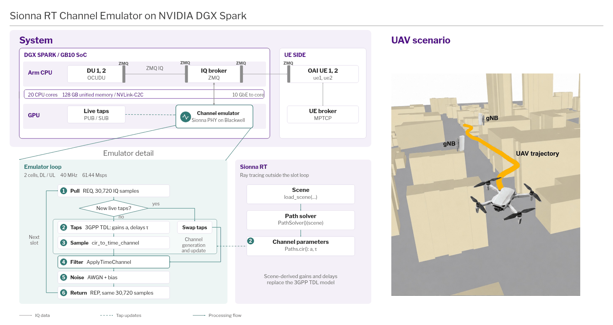
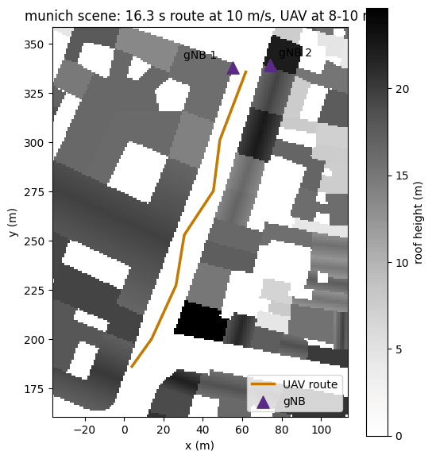
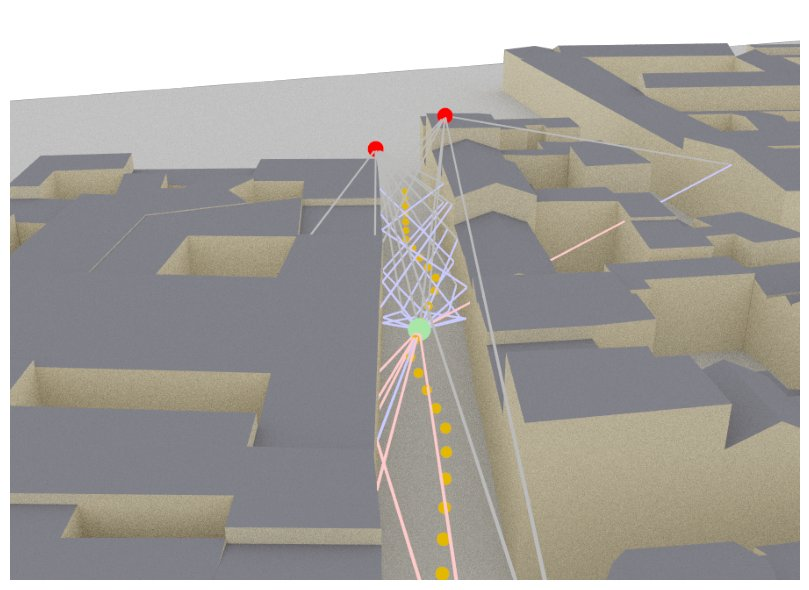
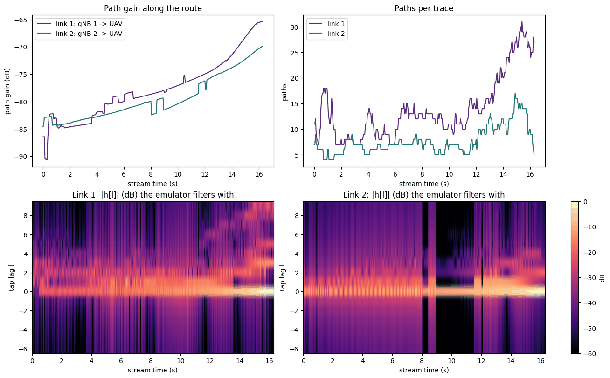

# Sionna RT channel emulator on NVIDIA DGX Spark

One DGX Spark stands in for the radio channel between two 5G cells and two UEs. The cells and UEs swap IQ samples over
ZMQ instead of over the air, and for every 0.5 ms slot a GPU emulator filters the samples with the current channel taps
and adds noise. Sionna RT supplies the taps: it ray-traces a UAV flying through a city street between the two cells and
sends the path gains and delays as *live taps*, so the channel follows the UAV.

This repository holds the Sionna RT side, built and checked, and [`web/spark/plan.md`](web/spark/plan.md), the
step-by-step plan for the rest. The slide's source is [`web/spark/brief-uav.html`](web/spark/brief-uav.html).

## The notebook

[`verify_uav_rt.ipynb`](spark/rt/verify_uav_rt.ipynb) answers one question before anything goes to the Spark: are the
taps Sionna RT produces right, and do they reach the emulator intact? It traces the whole flight with
[`uav_rt.py`](spark/rt/uav_rt.py), the same module the Spark will import, and runs 21 checks, each printing PASS or FAIL
with its numbers.

In Colab, pick a GPU runtime (*Runtime → Change runtime type → GPU*) and *Run all*. It also runs on a CPU, more slowly.

## Results on Colab (Tesla T4)

19 of 21 checks pass. The 327 traces, one every 50 ms of a 16.3 s flight, took 31 s.

### The route

 

The UAV starts in a square, turns into a 16 m wide street and flies up it at 8 to 10 m, below the roofs, towards two
gNBs on the rooftops at the far end. The 3D view is the slide's picture redrawn by Sionna: red gNBs, green UAV, orange
route, and the radio paths bouncing between the walls.

### What the emulator will see

- **Path gain** (top left) climbs about 15 dB on link 1 and 11 dB on link 2 as the UAV closes in: less distance, less
  loss. The small steps are reflections coming and going as the UAV passes the end of a wall.
- **Paths per trace** (top right): 4 to 31. Near the end, link 1 picks up many more wall reflections.
- **Taps** (bottom): the 16 numbers the emulator filters with. The bright row at lag 0 is the direct path; the fainter
  rows are echoes arriving a few samples later.

### The checks

| group | passed | what it shows |
|---|---|---|
| scene | 3 of 3 | the gNBs sit on roofs; the route stays 1.5 m clear of buildings; 95% of it runs between walls taller than the UAV (the rest is the square) |
| trace | 2 of 2 | every position traced; both links always have paths |
| physics | 4 of 4 | direct paths match free-space loss to 0.00002 dB and the speed of light to 0.0001 ns; no path beats free space over its own length; gain rises towards the gNBs |
| repeatability | 1 of 3 | see below |
| message | 3 of 3 | 327 messages survive encoding bit for bit; all 9 kinds of broken message are refused |
| taps | 2 of 2 | our tap code matches Sionna's own to one part in a million; 16 taps keep at least 95% of each link's energy |
| live taps over ZMQ | 4 of 4 | each of the 327 updates lands on exactly the right slot; broken or repeated messages change nothing |

**The two FAILs.** Re-tracing on the T4 found the same paths, but their gains moved by up to 0.16 dB, against a
0.01 dB limit set on a CPU, where traces repeat to 0.0001 dB. Why the GPU differs is not known yet. It does not reach
the emulator: the route is traced once and replayed from a file, and the replay check passed byte for byte. And 0.16 dB
is small next to the 15 to 25 dB the route itself moves.

**A finding for later.** 16 taps hold 99% of the energy at most points, but at a few, link 1 needs up to 129 taps:
some echoes arrive about 2 µs after the direct path.

## Next

- Settle the two FAILs: find what makes GPU traces differ, or set the limit from repeated T4 runs.
- Run the notebook on the DGX Spark, then connect `publish()` and `TapSwitch` to the emulator loop (plan.md steps 3, 10
  and 11), choosing the tap count with the 129-tap finding in mind.

## Where this started

This repository began as a copy of Ruibin Chen's RFSoC 4x2 waveform TX/RX design
([Ruibin2000/DDR_BRAM_tx_rx_v1](https://github.com/Ruibin2000/DDR_BRAM_tx_rx_v1)); the untouched import is on the
`ruibin-source` branch. His code (`hls/`, `vivado/`, `pynq/` and the rest) is unchanged, and his build guide is now
[`docs/RFSOC_BUILD.md`](docs/RFSOC_BUILD.md).
